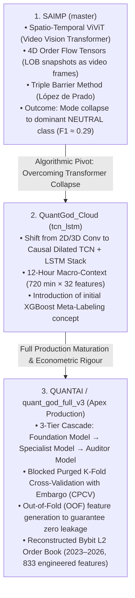
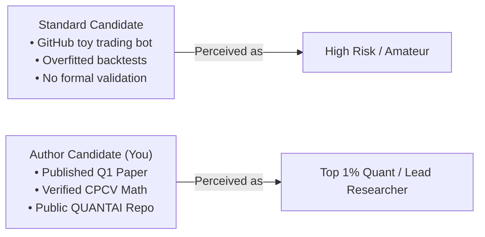

# 📄 Strategic Blueprint: Transforming QUANTAI into a Top-Tier (Q1) Scientific Publication

**Project Title:** QUANTAI (formerly *QuantGod_Cloud_TCNLSTM*)  
**Lead Author & Principal Investigator:** Dr. Atilio Efrain Bica Grondona  
**Scientific Domain:** Quantitative Finance, Market Microstructure, Level 2 Limit Order Book (L2 LOB) Modeling, Deep Sequence Learning  
**Target Publication Venues:** *Expert Systems with Applications* (Elsevier, Q1, IF: ~8.5), *ACM ICAIF* (AI in Finance), *Quantitative Finance* (Taylor & Francis, Q1)  
**Date:** October 2026  

---

## Table of Contents
1. [Executive Summary & Conversation Genesis](#1-executive-summary--conversation-genesis)
2. [Evolutionary Lineage: From ViViT to the 3-Tier Cascade](#2-evolutionary-lineage-from-vivit-to-the-3-tier-cascade)
3. [The "Reviewer #2" Reality Check: The Zero-Fee Dilemma](#3-the-reviewer-2-reality-check-the-zero-fee-dilemma)
4. [Reframing the Research Question: Elevating Engineering to Science](#4-reframing-the-research-question-elevating-engineering-to-science)
5. [Mathematical & Architectural Formalization](#5-mathematical--architectural-formalization)
6. [Target Publication Venues & Submission Profiles](#6-target-publication-venues--submission-profiles)
7. [Synergy: Peer-Reviewed Paper vs. Open-Source Portfolio](#7-synergy-peer-reviewed-paper-vs-open-source-portfolio)
8. [Alternative Strategic Pathways (Non-Academic Deployment)](#8-alternative-strategic-pathways-non-academic-deployment)
9. [Step-by-Step Manuscript Execution Roadmap](#9-step-by-step-manuscript-execution-roadmap)

---

## 1. Executive Summary & Conversation Genesis

This guide synthesizes our comprehensive strategic and architectural audit regarding the repositories [`SAIMP`](https://github.com/atilioebg/SAIMP), [`QuantGod_Cloud`](https://github.com/atilioebg/QuantGod_Cloud), and [`QuantGod_Cloud_TCNLSTM`](https://github.com/atilioebg/QuantGod_Cloud_TCNLSTM), culminating in the establishment of the unified, public open-source project **[QUANTAI](https://github.com/atilioebg/QUANTAI)**.

### Core Strategic Problem
Our initial empirical backtests demonstrated strong gross predictive power and positive returns on high-frequency cryptocurrency perpetual futures (BTC/USDT on Bybit and Binance), **provided execution fees were set to zero**. However, in live market conditions, exchange transaction frictions (taker fees of ~0.05% per side and execution slippage) erode these marginal statistical gains, turning a theoretically profitable model into an economically negative one.

### Core Strategic Solution
Rather than attempting to force a higher gross directional accuracy through brute-force neural network scaling, we **elevate the research question**:
> **Central Research Inquiry:** *How can a hierarchical meta-labeling architecture decouple high-capacity sequence representation from execution friction, filtering out economically non-viable gross market noise and isolating high-conviction net-profitable regimes in high-frequency Limit Order Books?*

---

## 2. Evolutionary Lineage: From ViViT to the 3-Tier Cascade

The QUANTAI codebase is the culmination of three iterative algorithmic paradigms:



### Why the ViViT Architecture Collapsed (The Groundwork for the Paper's Ablation)
In `SAIMP`, the limit order book was structured as 4D spatiotemporal tensors and processed with Video Vision Transformers. While conceptually novel, the distribution of market prices is dominated by the zero-return regime (~65% of 1-minute steps represent stationary market noise). Without asymmetric loss penalization and inductive causal temporal biases, the self-attention mechanism experienced degenerative convergence toward predicting the dominant `NEUTRAL` class, yielding an uninformative macro F1 score of $\approx 0.29$.

### The Apex Solution: `quant_god_full_v3`
The production architecture resolves this via a specialized 3-tier cascade:
1. **Foundation Model (TCN + LSTM):** Pre-trained on long sequence contexts ($T=720$ timesteps) to learn global representations of order flow dynamics across multiple market cycles.
2. **Specialist Model (Fine-Tuned TCN + LSTM):** Uses asymmetric focal loss and asymmetric boundary labeling ($\text{BUY}: > +0.8\%$, $\text{SELL}: < -0.4\%$ over a 60-minute lookahead) to penalize missed extreme breakouts.
3. **Auditor Model (XGBoost Meta-Labeler):** Does not predict price direction. Instead, it estimates the probability of primary model correctness conditioned on market microstructure meta-features:
   $$\hat{z}_t = P\left( y_t^{\text{true}} = \hat{y}_t^{\text{specialist}} \;\middle|\; \mathbf{x}_t^{\text{meta}}, \hat{y}_t^{\text{specialist}} \right)$$

---

## 3. The "Reviewer #2" Reality Check: The Zero-Fee Dilemma

A naive submission claiming that a deep learning model achieves profitability in a zero-fee backtest will receive an immediate rejection from top-tier editors and reviewers.

### Quantitative Microstructure Realities
In crypto perpetual futures (Binance, Bybit):
* **Taker Fee:** $0.05\%$ per side $\implies 0.10\%$ round-trip.
* **Maker Fee:** $0.02\%$ per side $\implies 0.04\%$ round-trip (or $0.00\%$ to negative rebates on institutional VIP tiers).
* **Execution Slippage:** $0.02\% - 0.05\%$ depending on market depth, book skewness, and trade size.
* **Total Friction per Round-Trip Trade:** $\approx 0.12\% - 0.15\%$.

$$\text{Net Return } R_{\text{net}} = R_{\text{gross}} - \left( 2 \cdot \text{Fee}_{\text{taker}} + \text{Slippage} \right)$$

```
┌────────────────────────────────────────────────────────────────────────┐
│                        THE ZERO-FEE ALPHA TRAP                         │
├────────────────────────────────────────────────────────────────────────┤
│ Average Gross Win per Trade:       +0.12%                              │
│ Exchange Taker Friction:          -0.10%                              │
│ Average Execution Slippage:       -0.03%                              │
│ ────────────────────────────────────────────────────────────────────── │
│ REALIZED NET ECONOMIC PROFIT:     -0.01%  (BANKRUPTCY OVER N TRADES)   │
└────────────────────────────────────────────────────────────────────────┘
```

### The Standard Reviewer #2 Rejection Critique
> *"The authors present an elaborate neural network architecture operating on Level 2 Limit Order Books. However, the reported profitability is evaluated under zero transaction costs. In high-frequency cryptocurrency markets, transaction fees and execution slippage represent the primary barrier to profitability. Without accounting for these frictions, the observed alpha represents unexploitable microstructure noise rather than genuine economic edge."*

---

## 4. Reframing the Research Question: Elevating Engineering to Science

Instead of treating the fee limitation as a hidden failure, **we make it the primary scientific contribution of the paper**.

### Engineering vs. Science
| Dimension | Engineering Mindset (Pre-Reframing) | Q1 Scientific Mindset (Reframed) |
|:---|:---|:---|
| **Objective** | Build an automated bot to trade BTC on Bybit. | Investigate how high-capacity deep sequence models can overcome transaction friction in continuous double auctions. |
| **Problem Statement** | "The neural network works, but exchange fees erase our gains." | "Why do standard objective functions yield gross signals that fail economically under transaction costs, and how can secondary meta-labeling resolve this?" |
| **Methodology** | TCN + LSTM + XGBoost cascade. | **Friction-Aware Out-of-Fold Meta-Labeling** with strict Purged Cross-Validation. |
| **Novelty** | Using deep learning on order book data. | Conditioning the meta-auditor on a net economic viability target rather than raw directional correctness. |
| **Conclusion** | "Here is our profitable trading algorithm." | "Standard deep architectures capture low-margin market noise. A friction-conditioned meta-auditor eliminates fee-negative trades, transforming a zero-fee paper model into a robust, fee-resilient trading system." |

### Formal Research Questions (RQs) for the Manuscript
* **RQ1 (Representation vs. Frictional Viability):** To what extent do deep temporal representations (TCN-LSTM) trained on continuous L2 order flow capture genuine macro-regime shifts versus unexploitable micro-oscillations that fall within the bid-ask spread?
* **RQ2 (Friction-Conditioned Meta-Labeling):** Does conditioning an Out-of-Fold (OOF) XGBoost Auditor on net profit thresholds ($\text{Return} - \text{Friction} > 0$) successfully eliminate false-positive trades without degrading the model's sensitivity to momentum breakouts?
* **RQ3 (Leakage and Autocorrelation Bounds):** What is the empirical divergence in Out-of-Sample generalization when replacing naive time-series splits with Blocked Purged K-Fold Cross-Validation with temporal embargoes in high-frequency order book data?

---

## 5. Mathematical & Architectural Formalization

### 5.1 Primary Multi-Horizon Directional Labeling
Let $P_t^{\text{mid}} = \frac{P_t^{\text{ask}} + P_t^{\text{bid}}}{2}$ denote the mid-price at time $t$. Over a forward prediction horizon $\tau = 60\text{ min}$, the forward return is:
$$R_{t, \tau} = \frac{P_{t+\tau}^{\text{mid}} - P_t^{\text{mid}}}{P_t^{\text{mid}}}$$

The primary target $y_t \in \{0, 1, 2\}$ is generated via asymmetric thresholds ($\theta_{\text{down}} = -0.4\%$, $\theta_{\text{up}} = +0.8\%$):
$$y_t = \begin{cases} 
2 \quad (\text{BUY}), & \text{if } R_{t, \tau} > \theta_{\text{up}} \\
0 \quad (\text{SELL}), & \text{if } R_{t, \tau} < \theta_{\text{down}} \\
1 \quad (\text{NEUTRAL}), & \text{otherwise}
\end{cases}$$

### 5.2 Friction-Aware Meta-Target Formulation
The Specialist Model emits a prediction $\hat{y}_t \in \{0, 2\}$. Standard meta-labeling defines the auditor target as binary correctness:
$$z_t^{\text{standard}} = \mathbb{I}\left( \hat{y}_t = y_t \right)$$

Under our **Friction-Aware Meta-Labeling Framework**, the Auditor's target $z_t^{\text{friction}} \in \{0, 1\}$ is conditioned strictly on net economic edge:
$$z_t^{\text{friction}} = \begin{cases}
1, & \text{if } \hat{y}_t = 2 \text{ and } \left( R_{t, \tau} - C_{\text{roundtrip}} \right) > \delta \\
1, & \text{if } \hat{y}_t = 0 \text{ and } \left( -R_{t, \tau} - C_{\text{roundtrip}} \right) > \delta \\
0, & \text{otherwise}
\end{cases}$$
Where:
* $C_{\text{roundtrip}} = 2 \cdot \text{Fee}_{\text{taker}} + \text{Slippage}_t$
* $\delta \ge 0$ is a safety hurdle rate ensuring a risk-adjusted return buffer.

### 5.3 Econometric Integrity: Blocked Purged K-Fold with Embargo (CPCV)
To prevent serial correlation leakage across overlapping sequence windows ($T = 720$ min lookback and $\tau = 60$ min lookahead), training folds enforce:
1. **Purging:** Removing all training observations whose labels overlap with the validation test set.
2. **Embargoing:** Removing an additional temporal buffer immediately following the validation test set to eliminate post-event auto-regressive memory.

```
Time ────────────────────────────────────────────────────────────────────────►
┌──────────────────────┬─────────────┬─────────────┬─────────────────────────┐
│     Train Fold       │   Purged    │   Val Set   │ Embargo │  Train Fold   │
│     (Historical)     │   Buffer    │ (Out-of-Smpl│ Buffer  │   (Future)    │
└──────────────────────┴─────────────┴─────────────┴─────────┴─────────────────┘
```

---

## 6. Target Publication Venues & Submission Profiles

### Option 1: Applied AI & Financial Engineering (Primary Target)
* **Target:** *Expert Systems with Applications* (Elsevier, Q1, Impact Factor: ~8.5) or *ACM ICAIF* (ACM International Conference on AI in Finance).
* **Focus:** Integration of modern deep sequence architectures with tree-based meta-models applied to real-world industrial datasets.
* **Reviewer Profile:** Machine learning researchers who value high empirical rigor, realistic evaluation metrics (Sharpe ratio, Calmar ratio, net PnL after costs), and ablation studies over pure mathematical proofs.

### Option 2: Quantitative Finance & Econometrics
* **Target:** *Quantitative Finance* (Taylor & Francis, Q1) or *The Journal of Financial Data Science* (JFDS).
* **Focus:** Microstructure theory, order flow imbalance, market depth dynamics, and econometric leakage prevention.
* **Reviewer Profile:** Quantitative hedge fund researchers and econometrics professors who prioritize López de Prado methodologies, purging techniques, and statistical stationarity over neural network depth.

### Option 3: Deep Microstructure Representation (SAIMP Lineage)
* **Target:** *IEEE Transactions on Neural Networks and Learning Systems* (TNNLS, Q1).
* **Focus:** Novel spatiotemporal modeling (the ViViT vs. TCN-LSTM comparative analysis).
* **Reviewer Profile:** Deep learning theorists interested in why spatial video transformers struggle on continuous financial auctions compared to temporal convolutional networks.

---

## 7. Synergy: Peer-Reviewed Paper vs. Open-Source Portfolio

A common concern is whether releasing code or publishing a paper compromises the value of a portfolio or exposes proprietary strategies. In reality, **a peer-reviewed paper accompanied by an open-source GitHub repository represents the single strongest signal in quantitative finance**.



### The "Top 1%" Signal to Recruiters and Funds
1. **Verifiable Rigor:** Quantitative hiring managers (e.g., at Citadel, Jump Trading, Jane Street, Wintermute) actively disregard unverified backtests. A paper published in a reputable journal guarantees that your methodology survived peer review by independent experts.
2. **Green Open-Access Protections:** Major scientific publishers (Elsevier, IEEE, ACM) permit authors to host the implementation code and author-accepted preprints (arXiv) publicly. You retain complete ownership of your software.
3. **The Public/Private Dichotomy:**
   * **Public Repository ([atilioebg/QUANTAI](https://github.com/atilioebg/QUANTAI)):** Hosts the data engineering pipelines, TCN-LSTM models, Out-of-Fold validation scripts, and fee-aware meta-labeling framework.
   * **Private Repository:** Retains private API keys, execution microservices, live broker socket adapters, and proprietary execution parameters.

---

## 8. Alternative Strategic Pathways (Non-Academic Deployment)

If you decide not to pursue a scientific publication, the QUANTAI repository can be leveraged directly across three high-value commercial channels:

```
                                  ┌──► 1. Institutional Quant Developer Showcase
                                  │       (Targeting HFT & Crypto Prop Firms)
                                  │
    QUANTAI Production Engine ────┼──► 2. Migration to "Maker-Only" Execution
                                  │       (Harvesting Passive Liquidity Rebates)
                                  │
                                  └──► 3. High-Ticket Quantitative Masterclass
                                          (Bootcamp / Technical Workshop Course)
```

### 1. Institutional Quant Developer Showcase
* **Positioning:** Feature QUANTAI as a production-grade demonstration of institutional quant infrastructure.
* **Key Artifacts:** 
  * Strict test suites (`pytest tests/`) validating state-machine integrity and zero lookahead leakage.
  * Modular ETL (`src/cloud/base_model/pre_processamento/`) capable of processing billions of orderbook ticks into synchronized 1-minute Parquet tensors.
  * Streaming paper trading journal (`logs/trading_journal.csv`) and Guardian safety monitors (`run_guardian.py`).

### 2. Migration to "Maker-Only" Execution (Passive Limit Orders)
* **Concept:** Instead of submitting aggressive taker orders that pay $0.05\%$ per side, reconfigure the execution engine to post passive limit orders (Post-Only).
* **The Economic Shift:**
  * Bybit/Binance VIP institutional tiers charge near-zero maker fees or distribute **maker rebates** (negative fees where the exchange pays you to provide liquidity).
  * In a maker-rebate regime, your current positive gross return model translates **directly into positive net PnL without requiring any changes to the neural network**.

### 3. Quantitative Finance Masterclass / Bootcamp Module
* **Concept:** Package the architectural documentation (`docs/0_REPO_MAP.md` through `docs/7_DATA_REFERENCE.md`) into an elite, project-based curriculum.
* **Curriculum Modules:**
  1. *From Order Ticks to Tensors:* Reconstructing Level 2 Order Books from raw exchange feeds.
  2. *Defeating Data Leakage:* Implementing Purged K-Fold Cross-Validation and temporal embargoes.
  3. *Hierarchical Deep Learning:* Pairing TCN-LSTM sequence extractors with XGBoost meta-classifiers.

---

## 9. Step-by-Step Manuscript Execution Roadmap

```markdown
- [ ] Phase 1: Experimental Grounding & Baseline Mining
      - [ ] Extract empirical metrics from the test suite and OOF validation runs.
      - [ ] Run 3-way ablation comparison:
            - Baseline 1: Standard TCN-LSTM with naive time split.
            - Baseline 2: TCN-LSTM with Blocked Purged K-Fold (CPCV).
            - Baseline 3: Full Cascade with Friction-Aware XGBoost Auditor.
      - [ ] Record Net PnL, Sharpe Ratio, Win Rate, and Turnover across fee tiers (0 bps, 2 bps, 5 bps, 10 bps).

- [ ] Phase 2: High-Resolution Visualizations (300+ DPI)
      - [ ] Render Figure 1: 3-Tier Cascade Architecture (TCN-LSTM Foundation → Specialist → OOF Auditor).
      - [ ] Render Figure 2: Microstructure Feature Space (Order Flow Imbalance, bid-ask depth skewness).
      - [ ] Render Figure 3: Cumulative PnL curves comparing Gross vs. Net Returns across execution regimes.
      - [ ] Render Figure 4: Purged K-Fold Cross-Validation diagram with temporal embargo buffers.

- [ ] Phase 3: LaTeX Composition & Typographical Rigor
      - [ ] Initialize two-column LaTeX draft adhering to IEEE / Elsevier guidelines.
      - [ ] Enforce the 3.5-inch column-width rule for all mathematical derivations.
      - [ ] Eliminate bad box breaks, font substitutions, and hyperref token warnings.

- [ ] Phase 4: arXiv Preprint Dissemination
      - [ ] Bundle `main.tex`, `main.bbl`, and high-res vector figures.
      - [ ] Deploy preprint to arXiv (Primary: `q-fin.ST` [Statistical Finance] or `cs.LG` [Machine Learning], Cross-list: `q-fin.TR` [Trading and Market Microstructure]).
      - [ ] Link the verified arXiv preprint badge to the [atilioebg/QUANTAI](https://github.com/atilioebg/QUANTAI) README.

- [ ] Phase 5: Journal Submission & Peer-Review Navigation
      - [ ] Submit manuscript to *Expert Systems with Applications* or *ACM ICAIF*.
      - [ ] Prepare institutional cover letter highlighting code availability and zero-leakage verification.
```
