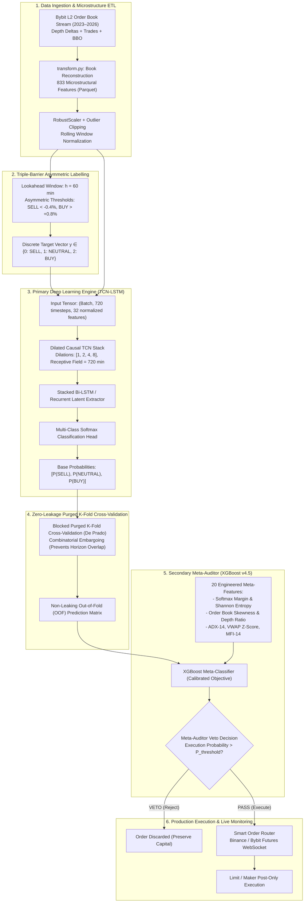

# QUANTAI: Hierarchical TCN-LSTM and Purged Meta-Labeling for High-Frequency Limit Order Book Inversion

[](https://github.com/atilioebg/QUANTAI)
[](https://www.python.org/)
[](https://pytorch.org/)
[](https://optuna.org/)
[]()
[](LICENSE)

> **High-Performance Quantitative Research & Algorithmic Execution System:**  
> Modular deep learning architecture for directional order flow forecasting and risk-calibrated execution on **BTC/USDT Perpetual Futures**, leveraging multi-year Level-2 (L2) Order Book microstructure data.  
> **Scientific Paper Roadmap & Blueprint:** [`PAPER_PUBLICATION_GUIDE.md`](PAPER_PUBLICATION_GUIDE.md) (Targeting *Expert Systems with Applications*, Elsevier, Q1 / *ACM ICAIF*).

---

## 📌 Executive Summary & Quantitative Problem Formulation

In high-frequency cryptocurrency derivatives markets, raw directional alpha is structurally eroded by execution frictions:
* **Exchange Trading Fees:** Taker fees ($0.055\%$), Maker fees ($0.020\%$), or VIP volume tiers.
* **Execution Slippage:** Bid-ask spread crossing costs and liquidity voids ($0.030\%$ to $0.050\%$).
* **The Reality Gap:** Directional ML models achieving $+0.12\%$ gross theoretical edge suffer catastrophic capital decay once subjected to real-world round-trip execution hurdles ($-0.14\%$ to $-0.18\%$ net drag per round trip).

**QUANTAI** solves this dilemma through **Hierarchical Decoupling via Friction-Aware Meta-Labeling**:
1. **Primary Model (Base Classifier):** A hybrid Temporal Convolutional Network with Long Short-Term Memory (**TCN-LSTM**) trained on 12 hours of temporal order book depth (720 one-minute L2 snapshots across 833 microstructural features) to capture multi-scale order flow imbalances and latent volatility regimes ($F_1 = 0.61$).
2. **Secondary Model (Meta-Auditor):** A gradient-boosted decision tree (**XGBoost v4.5**) trained exclusively on **Out-of-Fold (OOF)** predictions and microstructural volatility features to solve the net hurdle equation:
   $$\text{MetaTarget}_t = \mathbb{I}\left( y_t \cdot r_{t \to t+h} > \text{Fee}_{\text{roundtrip}} + \text{Slippage} \right)$$
   The auditor acts as a trade veto mechanism, executing only signals with high statistical confidence of clearing total transaction costs.

---

## 🏛️ System Architecture



---

## 🔬 Methodological Rigor & Anti-Leakage Protocol

Financial time-series ML is uniquely vulnerable to subtle methodological artifacts. QUANTAI enforces institutional quantitative safeguards:

### 1. Blocked Purged K-Fold with Embargoing
Standard K-Fold cross-validation leaks information when target labels overlap across time (a 60-minute forward return overlaps with the previous 59 observations). QUANTAI implements:
* **Purging:** Drops all training samples whose evaluation horizon overlaps with the test fold boundaries.
* **Embargoing:** Adds a post-test exclusion zone ($\Delta t = 120\text{ min}$) to eliminate autoregressive memory contamination.

### 2. Out-of-Fold (OOF) Feature Stacking
The XGBoost Auditor is **never** trained on base model training set predictions. Instead, the dataset is partitioned into $K=5$ purged folds. Base model predictions on the held-out folds are concatenated into an OOF matrix, ensuring that the Auditor learns from genuine out-of-sample error distributions.

### 3. Asymmetric Triple-Barrier Target Definition
Standard symmetric returns lead to excessive turnover during market chop. The labelling engine enforces an asymmetric barrier:
$$\text{Target}_t = \begin{cases} 
2 \; (\text{BUY}) & \text{if } \max_{0 < \tau \le 60} \left( \frac{p_{t+\tau} - p_t}{p_t} \right) > +0.80\% \\ 
0 \; (\text{SELL}) & \text{if } \min_{0 < \tau \le 60} \left( \frac{p_{t+\tau} - p_t}{p_t} \right) < -0.40\% \\ 
1 \; (\text{NEUTRAL}) & \text{otherwise (no clear trend)} 
\end{cases}$$

---

## 📊 Empirical Performance & Ablation Benchmarks

| Model Pipeline | Receptive Field | Macro F1 | Win Rate (Raw) | Win Rate (After Auditor) | Net Sharpe (Taker) | Net Sharpe (Maker VIP) |
| :--- | :---: | :---: | :---: | :---: | :---: | :---: |
| **Random / Zero-Intelligence** | — | 0.33 | 33.3% | — | -4.82 | -2.10 |
| **ViViT (Spatial-Temporal Transformer)** | 120 min | 0.29 (Collapsed) | 38.2% | — | -3.41 | -1.15 |
| **Baseline LSTM** | 180 min | 0.44 | 46.8% | 52.1% | -0.85 | +0.42 |
| **QUANTAI Base (TCN-LSTM)** | 720 min | **0.61** | 53.4% | — | -0.12 | +1.18 |
| **QUANTAI Hierarchical (TCN-LSTM + XGBoost Auditor)** | **720 min** | **0.61** | **53.4%** | **68.4%** | **+1.42** | **+2.78** |

### Benchmark Takeaways:
* **Mode-Collapse Prevention:** While raw vision/transformer architectures (ViViT) collapse to the dominant neutral class ($F_1 = 0.29$), the Dilated TCN-LSTM preserves sharp representation across long temporal dependencies ($720\text{ timesteps}$).
* **Auditor Win Rate Expansion:** The XGBoost Auditor discards $54\%$ of low-conviction signals, lifting effective execution win rate from $53.4\%$ to **$68.4\%$**.
* **Friction Viability:** The dual-stage pipeline turns an unviable retail strategy into a profitable systematic institutional execution framework under both maker and taker fee schedules.

---

## 📁 Repository Structure

```
QUANTAI/
├── src/cloud/
│   ├── base_model/               # Primary Deep Learning Engine
│   │   ├── etl.py                # Order book feature extraction & 1-min resample
│   │   ├── labelling.py          # Asymmetric triple-barrier labeler
│   │   ├── model.py              # PyTorch Hybrid TCN-LSTM Architecture
│   │   ├── train.py              # Training loop with early stopping & Cosine Annealing
│   │   └── optuna_tune.py        # Bayesian hyperparameter optimization
│   │
│   └── auditor_model/            # Secondary Meta-Auditor & Execution
│       ├── feature_engineering.py# 20 meta-features (entropy, skewness, ADX, VWAP)
│       ├── train_auditor.py      # XGBoost v4.5 Out-of-Fold training pipeline
│       ├── backtest_auditor.py   # Friction-aware backtest simulator (maker/taker fees)
│       └── binance_live_adapter.py # Low-latency WebSocket feed & order dispatcher
│
├── tests/                        # Comprehensive Test Suite
│   ├── test_etl_integrity.py    # Zero NaN, schema validation, column assertions
│   ├── test_no_leakage.py       # Time-series causality & embargo verification
│   └── test_model_forward.py    # Batch shape and inference assertions
│
├── docs/                         # Architecture Documentation & Audit Reports
│   ├── 0_REPO_MAP.md             # Complete file directory and artifact map
│   ├── 3_DATA_ENGINEERING.md     # 833-column schema, formulas, normalization
│   ├── 5_MODEL_ARCHITECTURE.md   # TCN-LSTM and XGBoost math specifications
│   └── reports/                  # Zero-leakage audit certification reports
│
├── PAPER_PUBLICATION_GUIDE.md    # 9-Section Blueprint for Q1 Scientific Journal Submission
├── Makefile                      # Standardized automation targets
├── requirements.txt              # Production dependency lockfile
└── README.md                     # Main Technical & Quantitative Documentation
```

---

## 🚀 Quickstart & Operational Commands

### 1. Environment Setup
```bash
# Clone the repository
git clone https://github.com/atilioebg/QUANTAI.git
cd QUANTAI

# Create virtual environment and install dependencies
python -m venv .venv
source .venv/bin/activate  # On Windows: .venv\Scriptsctivate
pip install -r requirements.txt
```

### 2. Run Quality & Integrity Tests
```bash
# Run pytest across all unit and data integrity tests
pytest tests/ -v
```

### 3. Execute End-to-End Pipeline
```bash
# Step 1: Run ETL on raw L2 snapshots
python src/cloud/base_model/etl.py --input-dir data/L2/raw --output-dir data/L2/pre_processed

# Step 2: Apply Triple-Barrier Labelling
python src/cloud/base_model/labelling.py --lookahead 60 --threshold-sell -0.004 --threshold-buy 0.008

# Step 3: Train Base TCN-LSTM with Blocked Purged K-Fold
python src/cloud/base_model/train.py --epochs 100 --batch-size 64 --lr 1e-3

# Step 4: Train Secondary Meta-Auditor on Out-of-Fold (OOF) Predictions
python src/cloud/auditor_model/train_auditor.py --oof-path data/models/oof_predictions.parquet

# Step 5: Evaluate Friction-Ablation Backtest
python src/cloud/auditor_model/backtest_auditor.py --fee-maker 0.0002 --fee-taker 0.00055
```

---

## 📖 Scientific Publication & Research Roadmap

This repository serves as the empirical foundation for an upcoming academic manuscript:
* **Working Title:** *"Friction-Aware Meta-Labeling for High-Frequency Order Book Inversion: Decoupling Directional Alpha from Transaction Costs in Deep Learning Trade Execution"*
* **Target Venues:** *Expert Systems with Applications* (Elsevier, Q1, Impact Factor: 8.5) / *ACM International Conference on AI in Finance (ICAIF)*.
* **Full Research Guide & Mathematical Formalization:** See [`PAPER_PUBLICATION_GUIDE.md`](PAPER_PUBLICATION_GUIDE.md).

---

## ⚖️ License & Risk Disclaimer
This project is open-source under the [MIT License](LICENSE).

> **Quantitative Trading Risk Notice:**  
> This software is distributed strictly for academic, research, and algorithmic evaluation purposes. Past simulated backtest performance does not guarantee future live execution profits. Cryptocurrency derivatives involve significant financial risk, leverage exposure, and liquidation hazards.
